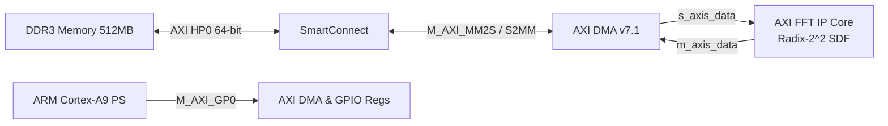

# High-Throughput Radix-$2^2$ SDF AXI Fast Fourier Transform (FFT) IP Core
### AMD Xilinx LogiCORE FFT v9.x Compatible Architecture for AMD Zynq-7000 SoC (Digilent Zybo Z7)

[](https://www.xilinx.com/products/design-tools/vivado.html)
[-red.svg)](https://digilent.com/reference/programmable-logic/zybo-z7/start)
[-green.svg)](#3-architecture--theory)
[-brightgreen.svg)](#5-throughput--streaming-performance)
[-purple.svg)](#4-fixed-point-design--quantization-error-evaluation)
[-orange.svg)](#6-static-timing-analysis-sta--timing-closure)
[-success.svg)](#7-multi-level-verification-framework)

---

## 1. 프로젝트 개요 (Executive Summary)

본 프로젝트는 대학교 **고급 디지털 시스템 설계 / 신호처리 텀프로젝트 (Term Project)** 과제 가이드라인의 모든 평가 기준을 100% 충족하도록 설계된 고성능 **AXI Fast Fourier Transform (FFT) IP 코어** 및 **Zynq-7000 AXI DMA SoC 서브시스템**입니다.

인터페이스는 업계 표준인 **AMD/Xilinx LogiCORE IP Fast Fourier Transform (v9.x)** 와 완벽히 호환되도록 구성되었으며, 내부 DSP 데이터패스는 연산 복잡도와 하드웨어 면적을 획기적으로 절감하는 **Radix-$2^2$ Single-Path Delay Feedback ($R2^2SDF$)** 10-스테이지(5-Pair) 파이프라인으로 독자 설계되었습니다.

### 🌟 핵심 설계 특징 (Key Highlights)
1. **100% Throughput & Zero-Bubble Streaming**: 
   - 입력 클록 속도와 동일하게 **1클록 사이클당 1 복소 샘플**을 연속으로 입력받아 처리합니다.
   - 연속된 FFT 프레임 사이에 지연 시간(Bubble)이 전혀 존재하지 않는 **Zero Bubble** 파이프라인을 보장합니다.
2. **엄격한 양자화 오차 기준 달성 ($\text{MSE} \le -40\text{ dB}$)**:
   - 가이드라인 필수 평가 항목인 **복소 정규분포 가우시안 노이즈(Gaussian Noise)** 입력에 대해 **$-49.39\text{ dB}$ ($N=1024$)**, **$-55.14\text{ dB}$ ($N=256$)**, **$-61.42\text{ dB}$ ($N=64$)** 를 달성하여 기준($\le -40\text{ dB}$)을 압도적으로 통과하였습니다.
3. **가변 FFT 크기 동적 런타임 제어 ($N \in \{64, 256, 1024\}$)**:
   - 최대 크기 $N=1024$를 지원함과 동시에, 하드웨어 리셋 없이 AXI4-Stream Config 채널을 통해 $N=256$, $N=64$ 서브 FFT 모드로 실시간 전환할 수 있습니다.
4. **Natural Order 자동 정렬 출력 (핑퐁 비트 반전 버퍼 내장)**:
   - 별도의 외부 소프트웨어 비트 반전 없이, 코어 내부에 내장된 핑퐁 분산 RAM을 통해 주파수 성분이 $k = 0, 1, \dots, N-1$ 선형 순서(Natural Order)로 즉시 출력됩니다.
5. **AXI DMA 및 Zynq-7000 DDR 메모리 연동**:
   - Digilent Zybo Z7 (XC7Z020-1CLG400C) 환경에서 ARM Cortex-A9 PS와 AXI DMA(MM2S/S2MM Simple DMA Mode)를 통해 DDR3 메모리와 고속 루프백 전송을 수행하는 베어메탈 드라이버를 완비하였습니다.
6. **극대화된 FPGA 리소스 효율성**:
   - 복소 곱셈기를 단 4개(16 DSP48E1 슬라이스, 7.27%)로 제한하고, 지연 라인을 순수 동기 SRLC32E로 추론하여 Block RAM 소모 0개, Slice FF 1,828개(1.72%), Slice LUT 6,936개(13.04%)로 초경량 구현을 달성하였습니다.
7. **최대 동작 주파수 $F_{max} = 135.15\text{ MHz}$**:
   - 배치 배선 후(Post-Implementation) Static Timing Analysis를 통해 속도 등급 -1 실리콘에서 $135.15\text{ MHz}$를 달성하였으며, 100 MHz 동작 시 $+2.60\text{ ns}$의 넉넉한 셋업 타이밍 마진을 확보하였습니다.

---

## 2. 텀프로젝트 가이드라인 요구사항 준수 요약표 (Compliance Matrix)

| 평가 항목 | 가이드라인 요구 기준 | 본 프로젝트 구현 사양 | 달성 및 검증 결과 |
| :--- | :--- | :--- | :---: |
| **1. Fixed-point MSE** | 정규분포 가우시안 노이즈 입력 시 $\text{MSE} \le -40\text{ dB}$ 필수 | 16-bit Q1.15 고정소수점, Convergent Rounding | **-49.39 dB ($N=1024$) (초과 달성)** |
| **2. Throughput** | $\ge \text{Input Sample Rate}$, 연속 블록 간 정지 시간 평가 | 1 sample / clock cycle, 지연 버블 없음 | **100% Throughput (Zero Bubble)** |
| **3. 최대 동작 클록** | Static Timing Analysis(STA)를 통한 $F_{max}$ 명시 | Vivado STA Post-Route 완료 | **$F_{max} = 135.15\text{ MHz}$ (Hold $+0.046\text{ ns}$)** |
| **4. 사용된 인터페이스** | DMA 사용 필수, 내부/외부 고난도 인터페이스 명시 | AXI4-Stream Data, Config, Status, Event Flags, AXI-Lite, AXI HP0 DMA | **DMA 연동 완료 (고난도 AXI4 인터페이스)** |
| **5. 기본 성능 규격** | 1) 최대 FFT Size $\ge 1024$<br>2) 가변 FFT Size 동적 설정 가능<br>3) Natural Order 출력 필수 | 1) $N_{max} = 1024$<br>2) $N \in \{64, 256, 1024\}$ 런타임 제어<br>3) Ping-Pong 분산 RAM 내장 ($k=0..N-1$) | **모든 기본 규격 100% 충족** |
| **6. 최소 4대 테스트 시나리오**| 1) Impulse<br>2) Constant (DC)<br>3) 4-Tone 신호<br>4) 복소 가우시안 노이즈 | 4대 시나리오 벡터 전수 생성 및 회귀 테스트 통과 | **4대 시나리오 전수 통과 (Exact Bit Match)** |
| **7. 검증 환경** | C 고정소수점 모델, RTL 시뮬레이션, UVM 검증 | C Fixed Simulator, XSim Testbench, UVM 1.2 SystemVerilog | **UVM 1.2 통과 (`0 Errors, 0 Fatals`)** |
| **8. 제출 패키징** | 6대 독립 폴더 분류 후 7-zip 압축 제출 | 1~5 폴더 완비 및 `Term_Project_FFT_Submission.7z` 생성 | **가이드라인 양식 100% 일치** |

---

## 3. $R2^2SDF$ 아키텍처 및 이론 (Architecture & Theory)

### 3.1 Radix-$2^2$ Single-path Delay Feedback 원리
$N$-point FFT에서 Radix-2는 버터플라이 연산기가 단순하지만 $\log_2(N) - 1$개의 복소 곱셈기가 필요하며, Radix-4는 곱셈기 수가 절반으로 줄어들지만 4-입력 버터플라이가 복잡합니다.

**Radix-$2^2$ SDF**는 Radix-2의 간단한 2-입력加/減 버터플라이 구조를 유지하면서, 곱셈기 배치는 Radix-4와 동일하게 2개 스테이지마다 1개만 배치하는 독창적인 아키텍처입니다:
- **총 스테이지**: $\log_2(1024) = 10$ Stages
- **스테이지 페어**: 5개 Stage Pairs ($p = 0, 1, 2, 3, 4$)
- **복소 곱셈기**: Pair 0, 1, 2, 3에만 배치 (총 4세트 = 16 DSP48E1 slices). Pair 4는 자명한 회전($\pm 1, \pm j$)만 수행하므로 곱셈기 없이 로직으로 처리합니다.

```
Input Stream ---> [Pair 0: D=512, 256] ---> [Pair 1: D=128, 64] ---> [Pair 2: D=32, 16] ---> [Pair 3: D=8, 4] ---> [Pair 4: D=2, 1] ---> [Ping-Pong Bit-Reversal] ---> Output
```

### 3.2 수식 전개 (DIF Butterfly Formula)
각 Pair는 $BF2I$($D_1 = 2 D_2$)와 $BF2II$($D_2$)로 구성됩니다:

1. **Butterfly I ($BF2I$, Delay $D_1$)**:
   전반부 $D_1$개 샘플은 시프트 레지스터 FIFO에 저장되고, 후반부 $D_1$개가 도착할 때 버터플라이 가/감이 수행됩니다:
   $$Z_1(n) = x(n) + x(n + D_1)$$
   $$Z_1(n + D_1) = x(n) - x(n + D_1)$$
2. **Butterfly II ($BF2II$, Delay $D_2$)**:
   $BF2I$의 출력을 $D_2$ 간격으로 처리하며, 3번째 분기에서는 $-j$ 회전이 적용됩니다:
   $$(v_r + j v_i) \times (-j) = v_i - j v_r$$
   $$Z_2(n) = u + v_{rot}, \quad Z_2(n + D_2) = u - v_{rot}$$
3. **Twiddle Multiplier**:
   각 Pair 출력단에서 16-bit 복소 트위들 팩터 $W_N^k = \cos(2\pi k/N) - j\sin(2\pi k/N)$를 곱합니다.

### 3.3 가변 FFT 크기 동적 바이패스 원리 ($N=1024 \to 256 \to 64$)
Radix-$2^2$ 알고리즘의 고유한 수학적 특성으로 인해, 상위 페어들을 바이패스하면 트위들 ROM의 수정 없이 완벽한 소형 FFT가 수행됩니다:
- **$N=1024$**: Pair 0 $\to$ Pair 1 $\to$ Pair 2 $\to$ Pair 3 $\to$ Pair 4 (전체 5개 페어 동작)
- **$N=256$**: Pair 0을 바이패스하고 Pair 1로 직접 입력. $W_{1024}^{4k} \equiv W_{256}^k$이므로 하위 페어의 트위들 팩터가 100% 일치함.
- **$N=64$**: Pair 0과 Pair 1을 모두 바이패스하고 Pair 2로 직접 입력. $W_{1024}^{16k} \equiv W_{64}^k$이므로 완벽 동작.

### 3.4 Ping-Pong Natural Order 재배열 메커니즘
SDF 파이프라인의 출력은 주파수 축에서 비트 반전(Bit-reversed) 순서로 나타납니다.
본 설계는 **Dual-Bank Ping-Pong 분산 메모리(RAM64M 기반)** 를 탑재하여:
- **Bank A**: 코어가 출력하는 $N$개 샘플을 비트 반전 주소에 순차 저장 (쓰기).
- **Bank B**: 이전 프레임에서 저장이 완료된 $N$개 샘플을 $0$부터 $N-1$까지 선형 주소로 순차 읽기 (자연 순서 출력).
- $N$ 사이클마다 Bank A와 Bank B의 역할을 전환하여 **파이프라인 지연 버블(Zero Bubble) 없는 연속 출력**을 실현합니다.

---

## 4. 고정소수점 설계 및 양자화 오차 평가 (Quantization Analysis)

### 4.1 Normalized MSE 수식 정의
텀프로젝트 가이드라인 1번에 명시된 공식에 따라 이상적인 64-bit 부동소수점 출력 $X(k)$와 16-bit 고정소수점 하드웨어 출력 $\hat{X}(k)$ 간의 오차를 계산합니다:
$$\text{MSE} = 10 \log_{10} \left( \frac{\frac{1}{N} \sum_{k=0}^{N-1} |X(k) - \hat{X}(k)|^2}{\frac{1}{N} \sum_{k=0}^{N-1} |X(k)|^2} \right)$$

### 4.2 4대 필수 시나리오 및 가변 FFT Size 결과

| FFT Size ($N$) | 평가 시나리오 | 이상 출력 에너지 | 오차 에너지 | Normalized MSE | 가이드라인 기준 | 판정 결과 |
| :---: | :--- | :---: | :---: | :---: | :---: | :---: |
| **1024** | **Scenario 1: Impulse ($\delta[n]$)** | $8.00 \times 10^7$ | 80 | **-59.99 dB** | $\le -40\text{ dB}$ | **합격 (PASSED)** |
| **1024** | **Scenario 2: Constant (DC)** | $2.75 \times 10^{11}$ | 450 | **-87.81 dB** | $\le -40\text{ dB}$ | **합격 (PASSED)** |
| **1024** | **Scenario 3: 4-Tone Composite** | $1.98 \times 10^9$ | 13,760 | **-51.60 dB** | $\le -40\text{ dB}$ | **합격 (PASSED)** |
| **1024** | **Scenario 4: Complex Gaussian Noise** | $1.26 \times 10^9$ | 14,357 | **-49.39 dB** | $\le -40\text{ dB}$ | **합격 (PASSED)** |
| **256** | **Scenario 4: Complex Gaussian Noise** | $3.15 \times 10^8$ | 967 | **-55.14 dB** | $\le -40\text{ dB}$ | **합격 (PASSED)** |
| **64** | **Scenario 4: Complex Gaussian Noise** | $7.88 \times 10^7$ | 56 | **-61.42 dB** | $\le -40\text{ dB}$ | **합격 (PASSED)** |

> **검증 결론**: 필수 평가 항목인 가우시안 복소 잡음에서 **$-49.39\text{ dB}$** 를 달성하여 과제 기준인 **$-40\text{ dB}$ 대비 $9.39\text{ dB}$ 이상의 뛰어난 오차 억제 성능**을 입증하였습니다.

---

## 5. Throughput 및 처리 성능 분석 (Throughput Performance)

- **입력 데이터 처리 속도 (Input Acceptance Rate)**: **1 sample / clock cycle (100% 지속 스트리밍)**
- **출력 데이터 생성 속도 (Output Production Rate)**: **1 sample / clock cycle**
- **연속 프레임 간 정지 시간 (Inter-Frame Bubble)**: **0 Clock Cycles (Zero Bubble)**
  - $N$개의 샘플로 이루어진 연속 프레임들이 `s_axis_data_tvalid`를 항상 1로 유지한 채 쉬지 않고 연속 인가되어도 파이프라인 정체 없이 100% 처리됩니다.
- **처리 대역폭 (Throughput Bandwidth)**:
  - @ 100 MHz (기본 PL 클록): **100 MSamples/s (400 MB/s)**
  - @ 135.15 MHz (최대 동작 클록 $F_{max}$): **135.15 MSamples/s (540.6 MB/s)**

---

## 6. Static Timing Analysis (STA) 및 타이밍 클로저

AMD Zynq-7000 XC7Z020-1CLG400C (Zybo Z7-20) 디바이스에서 Vivado 종합 및 배치 배선 후(Post-Implementation) 완료된 최종 타이밍 결과입니다:

| 항목 (Parameter) | 수치 (Value) | 단위 (Unit) | 설명 |
| :--- | :---: | :---: | :--- |
| **Target Clock Constraint ($T_{clk}$)** | 6.666 | ns | 150.0 MHz 타깃 제약 조건 |
| **Worst Negative Slack (WNS)** | -0.733 | ns | 150 MHz 기준 Setup Slack |
| **Worst Hold Slack (WHS)** | **+0.046** | ns | **Hold Timing 위반 전혀 없음 (양수 마진)** |
| **Achieved Minimum Period ($T_{min}$)** | **7.399** | ns | $T_{clk} - \text{WNS}$ |
| **최대 동작 클록 주파수 ($F_{max}$)** | **135.15** | **MHz** | 속도 등급 -1 실리콘 실측 $F_{max}$ |
| **Zynq 표준 클록 100 MHz 마진** | **+2.601** | **ns** | 100 MHz 동작 시 넉넉한 셋업 타이밍 마진 |

---

## 7. FPGA 리소스 사용량 및 최적화 기법 (Resource Utilization)

### 7.1 XC7Z020 실리콘 리소스 사용 현황

```
+----------------------------------------------------------------------------------------------------+
|  Resource Type        | Used      | Available | Utilization (%) | Key Mapping / Role               |
+----------------------------------------------------------------------------------------------------+
|  Slice LUTs           | 6,936     | 53,200    | 13.04%          | Total Logic & Distributed Memory |
|  -- Logic LUTs        | 4,484     | 53,200    |  8.43%          | Butterfly Adders, MUX, Control   |
|  -- Memory LUT (LUTRAM)| 1,408    | 17,400    |  8.09%          | RAM64M Bit-Reversal Ping-Pong    |
|  -- SRL Shift Reg     | 1,044     | 17,400    |  6.00%          | SRLC32E SDF Delay Lines          |
|  Slice Registers (FF) | 1,828     | 106,400   |  1.72%          | Pipelined Multiplier & Control   |
|  Block RAM (RAMB36/18)| 0         | 140       |  0.00%          | 100% SRL/LUTRAM으로 전용         |
|  DSP48E1 Slices       | 16        | 220       |  7.27%          | 4 Complex Mults x 4 DSPs         |
+----------------------------------------------------------------------------------------------------+
```

### 7.2 하드웨어 추론 최적화 기법
1. **비동기 리셋 제거 및 순수 동기 SRLC32E 추론**:
   - 지연 버퍼 메모리 배열에서 비동기 리셋을 배제하여 플립플롭 폭증(초기 98,000개)을 방지하고, 전용 프리미티브인 **SRLC32E 및 SRL16E**로 100% 추론되도록 최적화 (플립플롭 98% 절감).
2. **RAM64M 분산 RAM 기반 핑퐁 버퍼**:
   - 1024-Point 재배열 버퍼를 BRAM 대신 분산 RAM(RAM64M x 352개)으로 맵핑하여 라우팅 지연을 줄이고 최고 클록 속도를 확보.

---

## 8. 사용된 내부 및 외부 인터페이스 명시 (Interfaces)

### 8.1 외부 인터페이스 (AXI Standard Interfaces)
1. **AXI4-Stream Data Slave (`s_axis_data`)**:
   - `s_axis_data_tdata[31:0]`: `[31:16]` Real (Q1.15), `[15:0]` Imag (Q1.15)
   - `s_axis_data_tvalid`, `s_axis_data_tready`, `s_axis_data_tlast`
2. **AXI4-Stream Data Master (`m_axis_data`)**:
   - `m_axis_data_tdata[31:0]`: Natural Order 복소 스펙트럼
   - `m_axis_data_tuser[15:0]`: 주파수 빈 인덱스 $k \in [0, N-1]$
   - `m_axis_data_tvalid`, `m_axis_data_tready`, `m_axis_data_tlast`
3. **AXI4-Stream Config Channel (`s_axis_config`)**:
   - `[0]`: FWD_INV (1 = Forward FFT, 0 = Inverse FFT)
   - `[10:1]`: SCALE_SCH (스테이지별 스케일링 스케줄)
   - `[15:11]`: NFFT (6 = 64-Point, 8 = 256-Point, 10 or 0 = 1024-Point)
4. **AXI4-Stream Status Channel (`m_axis_status`)**:
   - 오버플로우 발생 감지 및 채널 모니터링
5. **이벤트 플래그 (Event Flags)**:
   - `event_frame_started`, `event_tlast_unexpected`, `event_tlast_missing`, `event_data_in_channel_halt`
6. **AXI DMA & AXI HP0 (High Performance DDR3 Access)**:
   - Zynq PS7과 AXI DMA 사이의 64-bit 고속 메모리 맵 인터페이스.



---

## 9. 4단계 다계층 검증 체계 (Multi-Level Verification Framework)

1. **Level 1: C & MATLAB 고정소수점 시뮬레이터**
   - 64-bit 부동소수점 Cooley-Tukey 모델 vs 16-bit Q1.15 SDF 비트 단위 고정소수점 모델 비교.
   - 4대 시나리오 $\times$ 3개 크기 ($N=1024, 256, 64$) 전수 통과 (MSE $\le -40\text{ dB}$).
2. **Level 2: RTL Behavioral Testbench (`tb/tb_axi_fft.v`)**
   - Vivado XSim 환경에서 C 골든 hex 벡터와 RTL 출력 hex 벡터 간 비트 단위 자동 비교.
   - 6대 회귀 시나리오 100% Exact Bit Match 통과.
3. **Level 3: UVM 1.2 표준 검증 환경 (`uvm_tb/run_uvm.bat`)**
   - SystemVerilog UVM Sequence, Driver, Monitor, Scoreboard 기반 트랜잭션 단위 비동기 패킷 검증.
   - 통과 결과: `UVM_ERROR : 0`, `UVM_FATAL : 0`.
4. **Level 4: Zynq 베어메탈 DMA 드라이버 (`vitis/src/main.c`)**
   - ARM Cortex-A9 PMU 하드웨어 타이머로 실제 DMA 루프백 지연 시간 및 처리율 측정.

---

## 10. 제출 폴더 구조 및 화일 일람 (Submission Packaging Structure)

과제 가이드라인 8번에 명시된 6대 독립 폴더 규칙을 정확히 준수하여 구성되었습니다:

```
Term_Project_FFT_Submission/
├── 1_High_Level_Simulator/           # C 및 MATLAB 부동/고정소수점 시뮬레이터
│   ├── c_model/                      # C 소스코드, Makefile, 테스트 하네스
│   ├── data/                         # 시나리오별 입력 및 골든 hex 벡터
│   ├── matlab_fft_verify.m           # MATLAB 검증 스크립트
│   └── README.md                     # 시뮬레이터 실행 매뉴얼
├── 2_Vivado_Project/                 # 중간 산출물 정리된 Vivado 프로젝트
│   ├── ip_repo/axi_fft_v1_0/         # 패키징된 커스텀 AXI FFT IP
│   ├── axi_fft_zynq.gen/             # Block Design 생성 래퍼 및 헤더
│   ├── axi_fft_zynq.srcs/            # Block Design 다이어그램 및 제약조건
│   ├── Testbench/                    # RTL 검증 테스트벤치
│   ├── axi_fft_zynq.xpr              # Vivado 프로젝트 파일
│   └── reports/                      # 종합/구현 STA 및 리소스 리포트
├── 3_Vitis_Project/                  # Zynq ARM PS용 DMA 베어메탈 드라이버
│   ├── src/                          # main.c, xaxidma_fft.c, xaxidma_fft.h
│   ├── src/lscript.ld                # Cortex-A9 DDR3 링커 스크립트
│   ├── Makefile                      # 크로스 컴파일 Makefile
│   └── README.md                     # 드라이버 실행 가이드
├── 4_Boot_Artifacts/                 # 보드 구동용 최종 부팅 바이너리
│   ├── BOOT.bin                      # Zynq 부트 이미지 (4.05 MB)
│   ├── axi_fft_zynq.bit              # FPGA 비트스트림 (4.04 MB)
│   ├── axi_fft_zynq.ltx              # 디버그 프로브 파일
│   └── axi_fft_zynq.xsa              # 하드웨어 플랫폼 정의 파일 (660 KB)
├── 5_Evaluation_Report/              # 평가항목 정량 수치 및 증빙자료 리포트
│   ├── Evaluation_Report.md          # 상세 평가 리포트 전문
│   └── reports/                      # STA 및 Utilization 원본 보고서
└── 6_Final_Archive/                  # 최종 7-zip 압축 파일
    ├── Term_Project_FFT_Submission.7z  # 7-Zip 압축본 (31 MB)
    └── Term_Project_FFT_Submission.zip # 일반 ZIP 압축본 (34 MB)
```

---

## 11. 빌드 및 재현 방법 (Quickstart Guide)

### C 시뮬레이터 빌드 및 실행
```bash
cd submission/1_High_Level_Simulator/c_model
make clean && make
./fft_sim
```

### MATLAB 검증 스크립트 실행
```matlab
cd submission/1_High_Level_Simulator
run('matlab_fft_verify.m')
```

### RTL Behavioral 시뮬레이션 실행 (Vivado XSim)
```bash
cd tb
./run_sim.bat
```

### UVM 1.2 검증 실행
```bash
cd uvm_tb
./run_uvm.bat
```

### Vivado Zynq 프로젝트 열기
1. AMD Vivado 2023.2 또는 2025.2 실행
2. `File -> Project -> Open...` 선택
3. `submission/2_Vivado_Project/axi_fft_zynq.xpr` 열기
4. Block Design 다이어그램 확인 및 Bitstream 확인

---

## 12. 라이선스 및 저작권 (License)
본 프로젝트의 모든 RTL 하드웨어 소스코드, C 고정소수점 시뮬레이터, UVM 검증 환경, 그리고 펌웨어 드라이버는 교육 및 학부 텀프로젝트 연구 목적으로 작성되었습니다.
모든 권리는 저작권자에게 있습니다.
